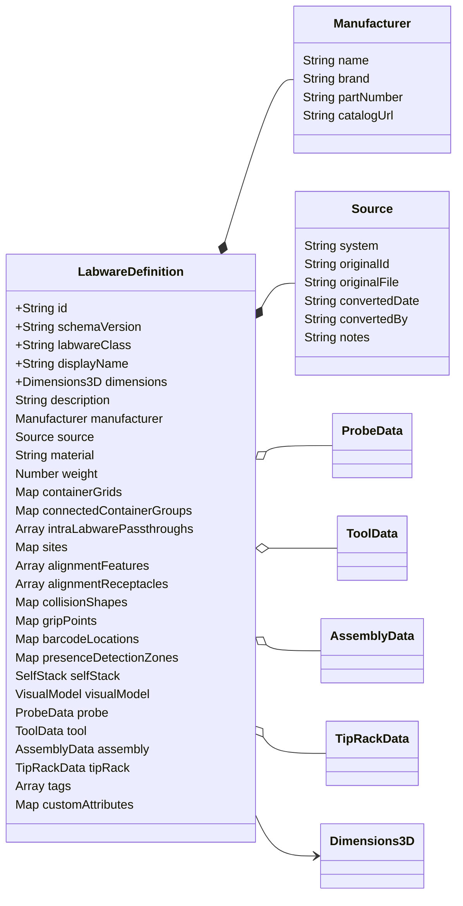
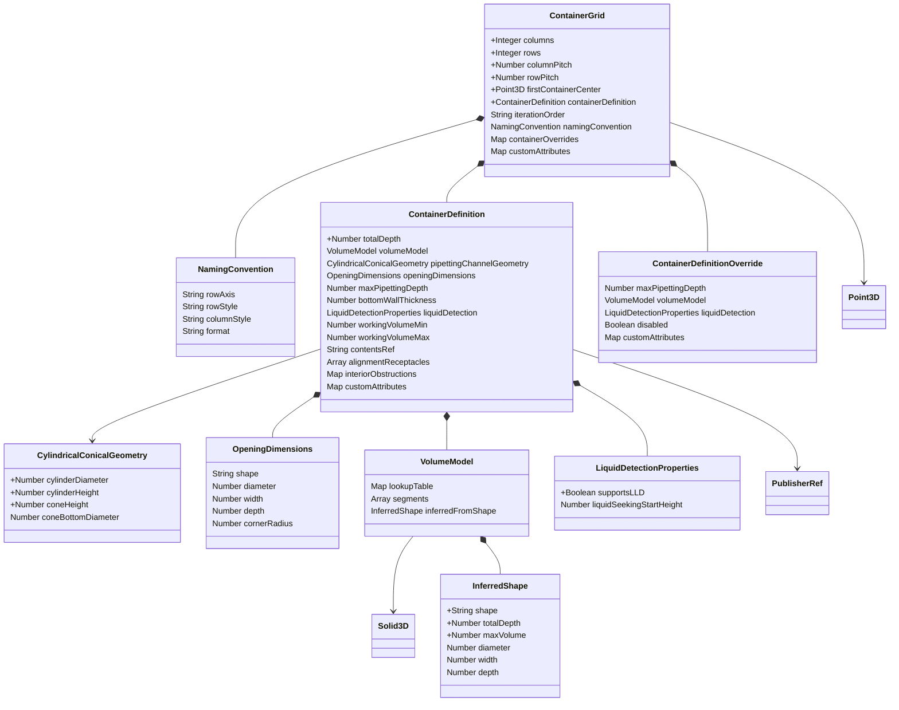
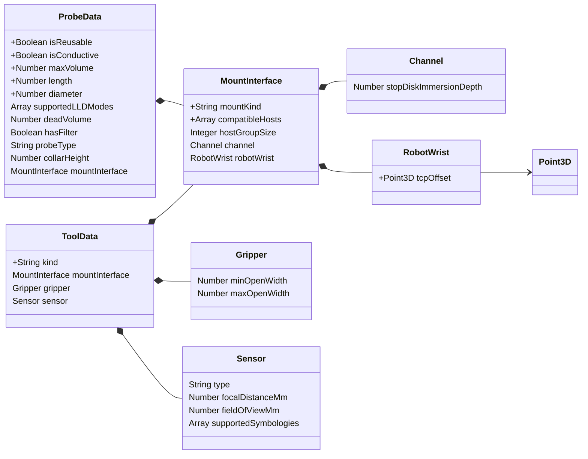
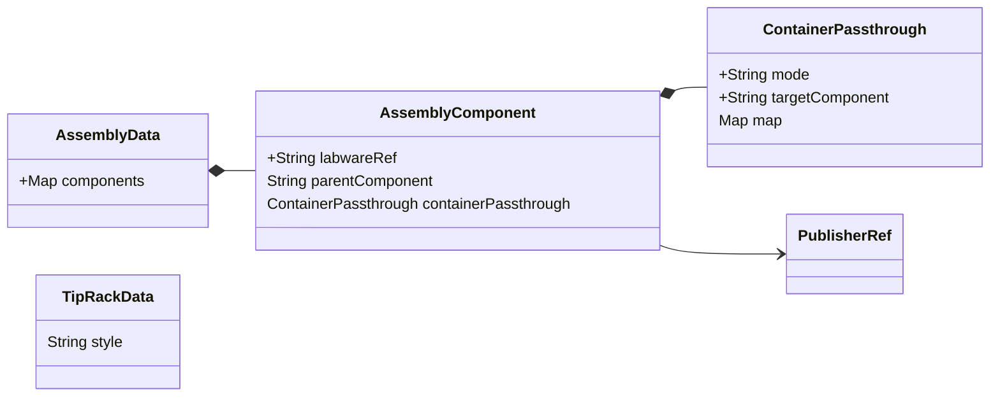
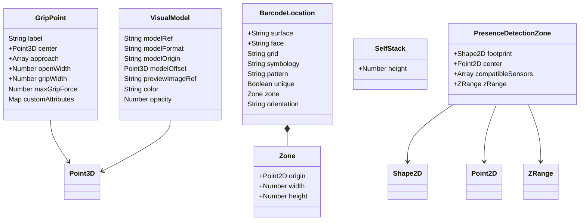
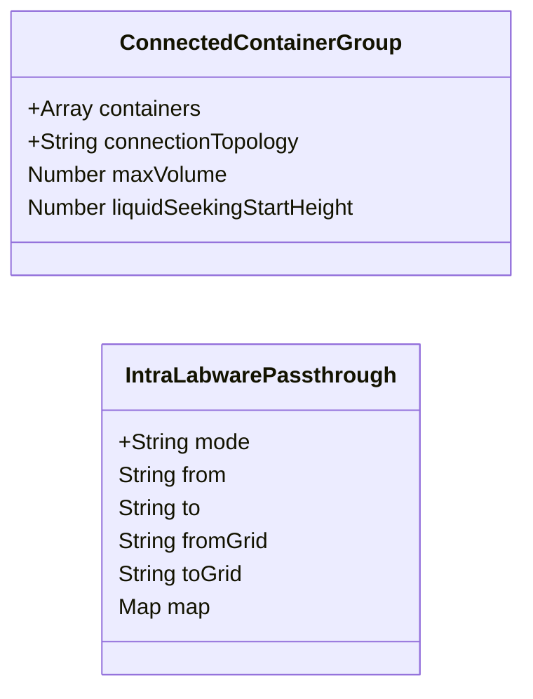
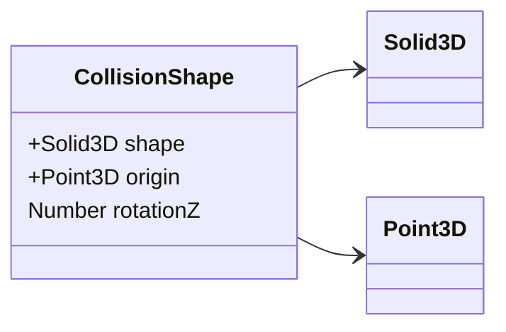
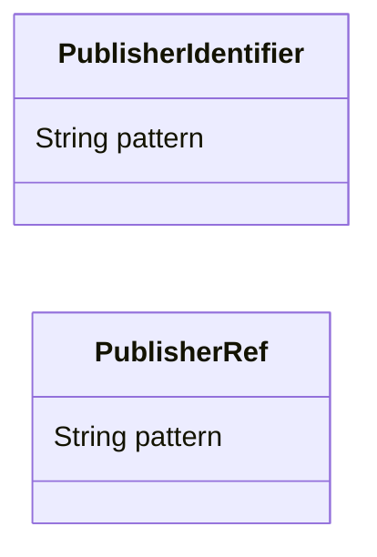
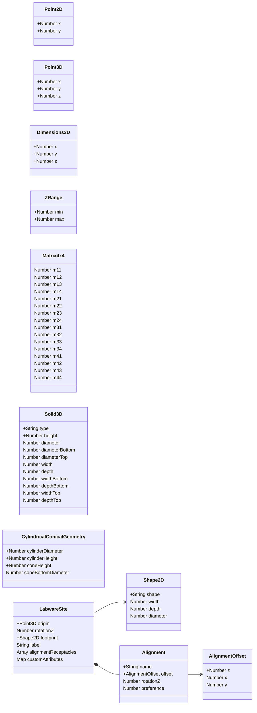
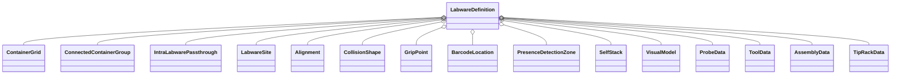

# Labware Schema — Class Diagrams

Visual reference for the labware schema (`urn:hamilton:schemas:microlab:labware:v1`). Rendered as Mermaid `classDiagram` blocks. Requires a Mermaid renderer (VS Code: install **"Markdown Preview Mermaid Support"** extension; GitHub renders natively).

## Conventions

| Notation | Meaning |
|---|---|
| `+field : type` | **Required** field |
| `field : type` | Optional field |
| `*--` | Composition (owns the referenced type) |
| `-->` | Reference (`$ref`-style link to another type) |
| `o--` | Conditional composition — present only for specific `labwareClass` values |

Enum values and constraints are listed in markdown beside each diagram.

---

## 1. Root structure

The labware document. The class-specific block (`probe` / `tool` / `assembly` / `tipRack`) is required when `labwareClass` matches; additional class blocks may accompany it when one labware physically plays several roles. `lid` carries no class-specific block — a lid is identified by `labwareClass: "lid"` and seats through its `alignmentFeatures`.

**Enum values**

- `labwareClass`: `plate | tip_rack | tube_rack | carrier | reservoir | probe | tool | lid | assembly | tube | adapter` (recommended; open snake_case vocabulary)
- `material`: `polypropylene | polystyrene | polycarbonate | cyclo_olefin | glass | quartz | stainless_steel | aluminum | peek` (recommended; open snake_case vocabulary)
- `source.system`: `venus | instinctv | mlprep | manual` (recommended; open snake_case vocabulary — other values accepted)

**Constraints**

- `schemaVersion` matches `^1\.\d+\.\d+(-[a-z0-9.]+)?$` (any 1.x.y; current target `1.0.0-alpha.1`)
- `id` follows `PublisherIdentifier` pattern; cross-references (`contentsRef`, `labwareRef`) follow `PublisherRef` (see §8)
- The class-matching block (`probe`, `tool`, `assembly`, `tipRack`) is required for its `labwareClass`; additional class blocks may accompany it for multi-role labware. `lid` and classes `plate`, `tube_rack`, `carrier`, `reservoir`, `tube`, `adapter` carry no dedicated class block — their required completeness aspects are stated in the next constraint
- What a *complete* definition of each **defined** class must carry — containers, seating features, sites — is enforced by the base schema's root coupling, so the catalog rejects an incomplete definition of a defined class (HTTP 422). A custom class matches no branch and is validated on the base schema alone (tour §10.6, ADR-MLAPI-0033 Compliance §1)

---

## 2. Container hierarchy

How a labware models its wells/tubes/tip-positions. `containerGrids` is a **keyed map** — the JSON key IS the grid identifier (`default` for single-grid labware).

**Enum values**

- `ContainerGrid.iterationOrder`: `column_major` (default) | `row_major`
- `NamingConvention.rowAxis`: `x | y`; `rowStyle` / `columnStyle`: `alpha | numeric`
- `OpeningDimensions.shape`: `circle | rectangle | rounded_rectangle`
- `VolumeModel.segments` items are the shared geometry `Solid3D` (§9) — six volume-precise primitives, a flat bottom-to-top stack with no per-segment transform
- `InferredShape.shape`: `flat_bottom_cylinder | flat_bottom_rectangle | v_bottom_cylinder | v_bottom_rectangle | u_bottom | round_bottom | parabolic_bottom`

**Constraints**

- `VolumeModel` requires at least one of `lookupTable`, `segments`, `inferredFromShape`. **Runtime precedence: `lookupTable` > `segments` > `inferredFromShape`**.
- `volumeModel` is required on a `ContainerDefinition` only when it holds liquid directly (no `contentsRef`); a tip/tube position omits it and delegates its occupant's volume to the `contentsRef` target. `totalDepth` is always required.
- `pipettingChannelGeometry` is the shared geometry `CylindricalConicalGeometry` (§9): what firmware-restricted pipetting channels receive for this container — a truncated cone joined flush under a cylindrical shaft. Optional and supplementary, never a `volumeModel` tier: volume math ignores it, and a container carrying it must still carry a `volumeModel` (`dependentRequired`). When absent, the runtime derives the shape from `volumeModel.segments`. Deliberately not validated against the volume model (authored deviation is intended; ADR-MLAPI-0043 §2.3). The `coneBottomDiameter ≤ cylinderDiameter` domain rule is a catalog check (validation-rules 2.9).
- `VolumeModel.segments` items are the geometry `Solid3D` (§9); its six primitives and per-type required dimensions are listed there. Segments form a flat bottom-to-top stack — no per-segment `origin` or `rotationZ`.
- All dimensional fields use **diameter** (not radius), consistent with `OpeningDimensions` and `InferredShape` and matching manufacturer spec-sheet conventions. Volume-integral consumers divide by 2 once.
- `InferredShape` shape-specific required fields:
  - circular shapes → `diameter`
  - rectangular shapes → `width` + `depth`
- `containerGrids` is a keyed JSON object (key = grid id); pattern `^[a-z0-9][a-z0-9_-]*$`; single-grid labware uses key `default`
- `containerOverrides` keys are container names ("A1", "H12") within this grid
- `contentsRef` uses `PublisherRef` (see §8)

---

## 3. Probe and Tool

Tips/needles and tools that mount onto a pipetting channel or a robot wrist. Both share `MountInterface` for the mount contract — **NOT** the tip-in-rack alignment (that lives in the tip's `alignmentFeatures` + the rack's `containerDefinition.alignmentReceptacles`).

**Enum values**

- `ProbeData.probeType`: `standard | wide_bore | low_retention | needle_blunt | needle_beveled` (recommended; open snake_case vocabulary)
- `ProbeData.supportedLLDModes` items: `capacitive | pressure`
- `MountInterface.mountKind`: `channel | robot_wrist` (open vocab; `channel` requires the `channel` block, `robot_wrist` the `robotWrist` block)
- `ToolData.kind`: `gripper | barcode_reader | optical_sensor | force_sensor` (recommended; open snake_case vocabulary — `gripper` requires the `gripper` block, sensor kinds the `sensor` block; custom kinds carry no required block)
- `Sensor.supportedSymbologies` items: `code128 | code39 | itf | datamatrix | qr | pdf417 | unknown`

**Constraints**

- `MountInterface.compatibleHosts` items use publisher form (`hamilton:core_channel_x1`, `hamilton:lablync_wrist`, etc.)
- `channel.stopDiskImmersionDepth` is probe-specific (Hamilton single/8-channel ≈ 8.0 mm, 384-head ≈ 7.55 mm); `robotWrist.tcpOffset` is the tool-center-point offset
- Functional probe categories (gel_loading, anti_static) go in `tags[]`, not in `probeType`
- Needle gauge (e.g. `"22G"`) goes in `tags[]` — it's an identification string, not driving math
- The `paddle` kind value and a corresponding block were deliberately omitted; reintroduce if a real channel-mounted paddle tool emerges

---

## 4. Assembly and TipRack

Class-specific blocks for `labwareClass = assembly | tip_rack`. `lid` carries no class-specific block — it uses `alignmentFeatures` to seat on a host's receptacle; `labwareClass: "lid"` is sufficient identification.

**Enum values**

- `AssemblyComponent` has no `role` field — the map key labels the component; the base is the single component that omits `parentComponent` (exactly one per assembly), and liquid routing is on `containerPassthrough`
- `ContainerPassthrough.mode`: `one_to_one | one_to_many | many_to_one | mapped` (the shared `PassthroughMode` `$def` — same vocabulary as `IntraLabwarePassthrough.mode`)
- `TipRackData.style`: `nestable | framed`

**Constraints**

- `AssemblyData.components` is a keyed map (`minProperties: 2`) — the JSON key is the component identifier, referenced by children's `parentComponent`; there is no `id` field
- Non-removable wraps (heat-sealed films, peelable foils) are a separate concept and should be modeled as a future `seal` labwareClass
- Every assembly component is separable by definition (a part that can never be separated is modeled as one labware, not an assembly component); there is no `removable` field. When a runtime actually separates a component is runtime behavior
- `ContainerPassthrough` requires `map` when `mode = "mapped"`
- `labwareRef` uses `PublisherRef` (see §8)

---

## 5. Cross-cutting metadata

`gripPoints`, barcodes, sensor detection, stacking, visual model — applicable across all labware classes.

**Enum values**

- `GripPoint.approach` items: `front | back | left | right | top | bottom`
- `BarcodeLocation.surface`: `labware | container`
- `BarcodeLocation.face`: `front | back | left | right | top | bottom | side`
- `BarcodeLocation.symbology`: `code128 | code39 | itf | datamatrix | qr | pdf417 | unknown`
- `BarcodeLocation.orientation`: `horizontal | vertical | null`
- `PresenceDetectionZone.compatibleSensors` items: `optical | capacitive | ultrasonic | weight | vision` (recommended; open snake_case vocabulary — a consumer skips zones naming sensors it lacks)
- `Shape2D.shape` (reused by PresenceDetectionZone.footprint and LabwareSite.footprint): `circle | rectangle`
- `VisualModel.modelFormat`: `obj | stl | gltf | glb | step` (recommended; open snake_case vocabulary — a renderer falls back to the bounding box on an unknown format)
- `VisualModel.modelOrigin`: `left_front_bottom | center_center_bottom | center_center_center`

**Constraints**

- `gripPoints` is a `Map<publisher:concept, Array<GripPoint>>`; keys pattern `^[a-z][a-z0-9_-]*:[a-z0-9][a-z0-9_-]*$`
- `barcodeLocations` and `presenceDetectionZones` are keyed maps — the JSON key is the entry's identifier; there is no `id` field
- `GripPoint.label` is an optional snake_case client-facing selector (pattern `^[a-z][a-z0-9_-]+$`, `maxLength: 60`) — lets a consumer reference a grip variant by name rather than array index; recommended unique within each instrument's grip-point array
- `GripPoint.maxGripForce` is a physical tolerance of the labware (it deforms above this force), not an operating value; instrument operating parameters (speeds, accelerations) ride in the grip point's `customAttributes` under the instrument's own namespace
- `BarcodeLocation` is discriminated via `allOf`:
  - `surface = labware` → `face` must be `front|back|left|right|top|bottom`
  - `surface = container` → `face` must be `side|top|bottom`
  - `grid` present → `surface` must be `container`
- `BarcodeLocation.zone` may be `null` (reader determines area)
- `Shape2D` shape-specific required fields (applies to `PresenceDetectionZone.footprint`, `LabwareSite.footprint`):
  - `circle` → `diameter`
  - `rectangle` → `width` + `depth`
- `VisualModel.color` pattern `^#[0-9A-Fa-f]{6}$`; `opacity` range `[0, 1]`

---

## 6. Multi-grid + intra-labware flow

`ConnectedContainerGroup` for shared volume pools (reagent troughs) — a keyed map like `containerGrids`, with the group identifier as the JSON key. `IntraLabwarePassthrough` for liquid flow between grids within one labware (dispense control plates).

**Enum values**

- `ConnectedContainerGroup.connectionTopology`: `base | side | full | merged_above`
- `IntraLabwarePassthrough.mode`: `one_to_one | one_to_many | many_to_one | mapped` (the shared `PassthroughMode` `$def` — same vocabulary as `ContainerPassthrough.mode`)

**Constraints**

- `connectedContainerGroups` is a keyed map — the JSON key is the group identifier; there is no `id` field
- `ConnectedContainerGroup.containers` items are either a qualified `gridId.containerName` or a bare `gridId` (= all containers in that grid); pattern `^[a-z0-9][a-z0-9_-]*(\.[A-Za-z0-9_-]+)?$`
- `IntraLabwarePassthrough` enforces exactly one of: `(from + to)` OR `(fromGrid + toGrid)` via `oneOf`
  - `from` / `to` use qualified form `gridId.containerName`
  - `fromGrid` / `toGrid` use bare grid id
- `IntraLabwarePassthrough` requires `map` when `mode = "mapped"`
- Position-level (`from`/`to`) entries are constrained to `mode = "one_to_one"` with **no** `map`; fan-out (`one_to_many`), convergence (`many_to_one`), and `mapped` routing must use the grid-level (`fromGrid`/`toGrid`) form

---

## 7. External collision geometry

`CollisionShape` for external features (carrier corner tabs, multiflex pedestals, mounting brackets). Its `shape` uses the shared geometry `Solid3D` (§9) — collision bodies are coarse over-approximations, so the prism/frustum primitives are the usual choice, but the catalog is not restricted.

**Enum values**

- `CollisionShape.shape` is the shared geometry `Solid3D` (§9) — its six primitives are listed there; the prism/frustum ones are the usual coarse-envelope choice

**Constraints**

- Shape-specific required fields are defined by the shared geometry `Solid3D` (§9) — the same type → required-dims coupling the volume segments use.
- `collisionShapes` is a keyed map — the JSON key is the shape's identifier; there is no `id` field

---

## 8. Identifier shared `$defs`

Two shared patterns used wherever a labware-domain identifier appears.

**Patterns**

- `PublisherIdentifier`: `^[a-z][a-z0-9_-]*:[A-Za-z0-9][A-Za-z0-9_-]*$`
  - Used by: `LabwareDefinition.id` (the labware's own identity, no pinning)
  - Examples: `hamilton:nunc_96_flat`, `hamilton:TR384t50gchm4COR`
- `PublisherRef`: `^[a-z][a-z0-9_-]*:[A-Za-z0-9][A-Za-z0-9_-]*$`
  - Used by: `contentsRef`, `labwareRef`
  - Examples: `hamilton:nunc_96_flat`, `hamilton:probe_core_300ul`
  - References are bare and resolve to the catalog's current representation when used; MicrolabAPI pins loaded content by content hash at execution time and records it in audit entries — pinning is never written into documents

**Rules**

- Publisher portion: lowercase letters/digits/underscore/hyphen, starting with a letter
- Identifier portion: permits mixed case to accommodate Hamilton legacy codes
- Reserved publishers (do not register): `mlapi`, `hamilton` (publisher-locked via signing)

---

## 9. External schema references

Types defined in sibling schemas, referenced by URN (not relative path): the geometry schema (`urn:hamilton:schemas:microlab:geometry:v1`), the site schema (`urn:hamilton:schemas:microlab:site:v1`), and the alignment schema (`urn:hamilton:schemas:microlab:alignment:v1`).

**Enum values**

- `Shape2D.shape`: `rectangle | circle`
- `Solid3D.type`: `cylinder | rectangular_prism | conical_frustum | rectangular_frustum | spherical_cap | paraboloid` (the shared 3D solid-primitive catalog)
- `CylindricalConicalGeometry` is a named shared type, **not** a `Solid3D` variant (the solid catalog stays closed): the restricted pipetting-channel container shape — a truncated cone joined flush under a cylindrical shaft (the cone's upper diameter *is* `cylinderDiameter`). Heights may be 0 (cone-only or shaft-only); `coneBottomDiameter` present exactly when `coneHeight > 0` and never exceeds `cylinderDiameter` (ADR-MLAPI-0034 §2.4)
- `Alignment.name`: **open vocabulary** — an interface-identity name (footprint/role or product), e.g. `sbs_rim | sbs_lid | mfx_module | pcr96_well_cradle`; the common mechanisms (rim seat, nest, pin-and-hole, well-cradle, …) are recorded in conventions §5. Optional `publisher:` prefix for vendor-private matings. Pattern `^([a-z][a-z0-9_-]*:)?[a-z][a-z0-9_-]+$`; matched by exact string equality between feature and receptacle.

**Constraints**

- `Dimensions3D` represents the labware's outer bounding box (width, depth, height in mm)
- `Matrix4x4` is row-major (identity = no transformation)
- `LabwareSite.alignmentReceptacles[]` are matched against the placed labware's `alignmentFeatures[]` (see §1)
- `LabwareSite` is labware-local: it flattens the shared site-schema `SiteDefinition` (`label` / `footprint` / `alignmentReceptacles` / `customAttributes`) via `allOf` + `$ref` + `unevaluatedProperties`, and adds the placement fields `origin` (required — the footprint center) and `rotationZ`. `SystemSite` flattens the same `SiteDefinition` with system-level fields.
- A footprint mismatch or over-size condition at a site is a soft warning, never a hard block
- `Solid3D` per-type required dimensions (all also carry `height`): `cylinder`/`spherical_cap` → `diameter`; `conical_frustum` → `diameterBottom`+`diameterTop`; `paraboloid` → `diameterTop`; `rectangular_prism` → `width`+`depth`; `rectangular_frustum` → `widthBottom`+`depthBottom`+`widthTop`+`depthTop`. All dimensional fields use diameter (not radius).
- `Solid3D` is the one shared solid catalog, referenced by `VolumeModel.segments` (§2), `CollisionShape.shape` (§7), and `InteriorObstruction.shape` — no per-consumer restriction.

---

## 10. High-level wiring

Just the compositions, no fields — quick overview of what `LabwareDefinition` owns.

`o--` is used throughout because every owned type is conditional in some sense — class-specific blocks depend on `labwareClass`; container grids exist only on labware that has containers; collision shapes are optional.
